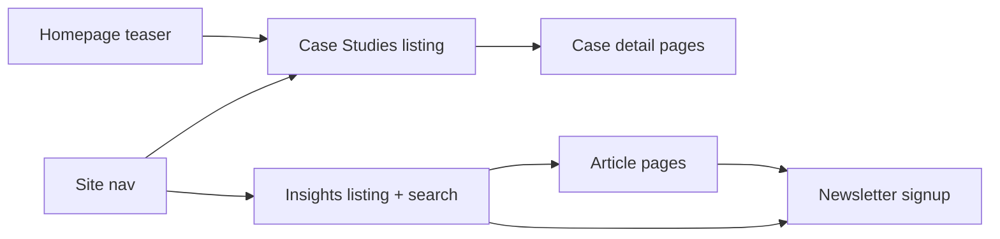

# Case Studies, Insights & Newsletters

**Status:** Implemented (v1)  
**Site:** [www.prodatalytics.com](https://www.prodatalytics.com) — static HTML + Tailwind + GitHub Pages

Add two nav destinations — **Case Studies** and **Insights** — plus a distinct **newsletter** product on Insights. Ship five case studies, five long-form articles, and five newsletter series themes with signup and article search. No CMS.

---

## Why separate pages

Strong consulting / data-science sites keep proof and thought leadership apart:

| Brand | Proof | Thought leadership |
|-------|--------|-------------------|
| [McKinsey](https://www.mckinsey.com/about-us/case-studies) | Case Studies | Insights / research |
| [LatentView](https://www.latentview.com/case-studies/) | Case Studies | Blog |
| [InData Labs](https://indatalabs.com/) | Case Studies (outcomes) | Blog (topics + dates) |
| Valantic | Customer success stories | Practical insights |

**Why:** Case studies convert (“we solved a problem like yours”); insights build authority and are browsed or searched over time. Mixing them weakens both jobs.

**Decision for PRODATALYTICS:** two nav items — **Case Studies** and **Insights** — not a single Resources hub.



---

## Scope (first ship)

- **5 case studies** — Challenge → Approach → Outcome
- **5 long-form insight articles** — detailed reads; searchable
- **Newsletter product** — five named short-form series (2–5 min reads), distinct from articles; signup on Insights
- **Client-side search** on the Insights article listing only
- **Content templates** in-repo for cases, articles, and newsletter issues
- Preserve dark theme, chrome patterns, and brand tokens; edit `css/tailwind.css` only (rebuild `css/main.css`)

---

## Information architecture

Avoid `case-studies.html` + `case-studies/` conflicts on GitHub Pages:

```
pages/case-studies/index.html          # listing
pages/case-studies/<slug>.html         # 5 details
pages/insights/index.html              # articles + search + newsletters
pages/insights/<slug>.html             # 5 articles
data/insights-index.json               # searchable metadata
js/insights.js                         # filter/search + newsletter thanks
docs/content-templates.md              # fill-in briefs
```

**Relative paths from nested pages:** `../../css/…`, `../../js/…`, `../../assets/…`. Sibling nav: `../services.html`, etc. Home: `../homepage.html` (existing subpage convention).

Update [`.cursor/rules/html-pages.mdc`](../.cursor/rules/html-pages.mdc) with the nested-path rule when implementing.

---

## Nav + chrome

Add **Case Studies** and **Insights** to header + mobile menu on every main page:

- `index.html`, `pages/homepage.html`
- `pages/services.html`, `pages/about.html`, `pages/contact.html`
- New nested pages

**Order:** Home · Services · Case Studies · Insights · About · Contact  
(Contact stays the CTA-styled link.)

**Homepage:** **Selected work** — three of the five cases as compact teasers linking to the full listing.

---

## Design (simple, on-brand)

Reuse patterns from `css/tailwind.css` (`.section-*`, `.card`, `.form-input`, `.btn-primary`).

| Surface | Layout |
|---------|--------|
| Case Studies listing | Quiet hero + grid of five cards (industry tag, title, one-line outcome, “Read case”) |
| Case detail | Challenge → Approach → Outcome → CTA to Contact; one composition, no hero card clutter |
| Insights listing | (1) **Articles** — search + tags + grid; (2) **Newsletters** — series strip + signup (not mixed into search) |
| Article detail | Title, date, tags, body, back link, soft CTA, compact newsletter signup at foot |

Optional new helpers: `.content-prose`, `.tag-chip`, `.newsletter-block`, `.series-card`. Rebuild `css/main.css` after changes.

Where concrete % / $ or client names are not yet approved, ship directional outcomes only—never live `[Metric pending]` placeholders on public pages.

---

## Newsletter vs articles

| | Articles / Insights posts | Newsletters |
|--|---------------------------|-------------|
| Job | Thought leadership, SEO, depth | Habit, skim, recurring touch |
| Length | Detailed (~5–10+ min) | Short, insightful, **2–5 minute** reads |
| On site | Full HTML pages + search index | Series themes + signup; issues emailed (archive later) |
| Cadence | As published | Monthly (per series positioning) |

Do **not** duplicate the five newsletter themes as five more blog posts.

### Newsletter series

| Series | Cadence pitch | Focus |
|--------|---------------|--------|
| **AI Pulse** | Monthly roundup | Latest AI / GenAI / data science trends, major announcements, business implications |
| **Data Science in Action** | Practical stories | Real-world success stories, use cases, lessons from deploying ML and GenAI |
| **Tech Spotlight** | One tech / month | Short dive (AI Agents, MCP, GraphRAG, vector DBs, LLMOps, multimodal…) — business applications |
| **The Data-Driven Enterprise** | Tips & checklists | Governance, MLOps, AI adoption, analytics maturity |
| **AI Myth vs Reality** | Myth-busting | What today’s AI/DS can and cannot realistically achieve |

**Placement**

- Primary: **Newsletters** section on `pages/insights/index.html` — series cards + signup
- Echo: foot of each article (“Prefer a 2–5 min monthly brief? Subscribe.”)

**Signup (FormSubmit)**

- Destination: `hello@prodatalytics.com` (same as Contact; do **not** change Contact forms)
- `_subject`: `Newsletter Signup - PRODATALYTICS`
- `_next`: `https://www.prodatalytics.com/pages/insights/index.html#newsletter-thanks`
- Fields: email (required); optional checkboxes for the five series; honeypot
- Thanks UX via `#newsletter-thanks` in `js/insights.js`

**v1 limit:** FormSubmit captures email + interests into inbox — not a campaign ESP. Later: Mailchimp / Buttondown / ConvertKit with the same series names. On-site issue archives are out of v1.

---

## Case studies (5)

| # | Slug | Title | Industry | Summary |
|---|------|-------|----------|---------|
| 1 | `renewable-energy-grid-optimization` | Renewable Energy Demand Forecasting & Grid Optimization | Energy | AI/predictive models for electricity demand, renewable generation, and grid load — optimize distribution, improve stability, reduce ops cost |
| 2 | `clinical-trial-patient-recruitment` | Clinical Trial Analytics & Patient Recruitment Optimization | Life sciences | ML for eligible cohorts, site selection, retention monitoring, faster trial execution with regulatory compliance |
| 3 | `enterprise-ai-knowledge-assistant` | Enterprise AI Assistant & Intelligent Knowledge Management | Enterprise | Secure GenAI (LLMs + RAG) for NL search, summarization, workflow automation, contextual Q&A over knowledge sources |
| 4 | `fraud-detection-financial-risk` | Fraud Detection & Financial Risk Analytics | Financial services | Fraud detection + risk scoring — suspicious transactions, anomalies, creditworthiness, real-time decisions |
| 5 | `retail-demand-customer-intelligence` | Retail Demand Forecasting & Customer Intelligence | Retail | Demand forecast, inventory optimization, personalized recommendations, purchase-behavior analytics |

**Detail page structure**

- **Challenge** — domain pain (volatile renewables load; slow enrollment; trapped knowledge; fraud vs false positives; stockouts vs overstock)
- **Approach** — bullets from the summary (consulting-level methods)
- **Outcome** — directional benefits on the public site; add concrete % / $ only after approval

Client names stay anonymized by industry unless approved names are supplied later.

---

## Insights / articles (5)

| # | Slug | Title | Tags | Angle |
|---|------|-------|------|-------|
| 1 | `ai-chatbots-to-ai-agents-2026` | From AI Chatbots to AI Agents: What Businesses Need to Know in 2026 | Agentic AI, Strategy | How Agentic AI goes beyond chatbots; where businesses see the greatest ROI |
| 2 | `why-enterprise-ai-projects-fail` | Why Most Enterprise AI Projects Fail—and How to Make Yours Successful | Enterprise AI, Best practices | Common AI adoption pitfalls; practices for scalable, production-ready solutions |
| 3 | `rag-enterprise-knowledge-management` | Retrieval-Augmented Generation (RAG): The Future of Enterprise Knowledge Management | RAG, GenAI, Knowledge | Securely leverage internal data with GenAI for productivity and decisions |
| 4 | `predictive-analytics-alongside-genai` | Predictive Analytics in the Age of Generative AI: Why Machine Learning Still Matters | ML, Predictive analytics | Why classical ML / predictive analytics still matter beside GenAI |
| 5 | `ai-readiness-assessment` | AI Readiness Assessment: Is Your Organization Ready for Enterprise AI? | Strategy, Governance | Practical guide — data quality, infrastructure, governance, processes before investing |

**Optional cross-links:** RAG article ↔ Enterprise AI Knowledge case; Predictive analytics ↔ Retail / Energy / Fraud cases; AI readiness ↔ consultation CTA.

Use staggered placeholder publish dates (e.g. 2026-01 through 2026-05) so the listing sorts cleanly.

### Article search

`data/insights-index.json` fields: `slug`, `title`, `date`, `excerpt`, `tags`, `href`.

`js/insights.js`: fetch index, debounce filter, render results; newsletter thanks hash.

**Adding an article later:** new HTML under `pages/insights/` + one JSON row.

---

## Content templates (prepare offline)

These shapes will also live in `docs/content-templates.md` when the feature ships.

### Case study brief

```text
Slug: (see case table)
Title: (see case table)
Industry / anonymized client label:
Service area: (Consulting | ML | Training | Statistical reporting | Workshops | Research)
One-line outcome: (what changed for the business)

Challenge: (2–4 sentences — situation + pain)
Approach: (bullets — what PRODATALYTICS did)
Outcome: (2–4 bullets — measurable or qualitative; mark figures needing approval)
Quote: (optional — only with permission)
CTA note: (default = book a consultation)
```

### Insight / article brief

```text
Slug: (see insights table)
Title: (see insights table)
Date: (YYYY-MM-DD)
Tags: (see table; adjust as needed)
Excerpt: (1–2 sentences for listing + search)
Body: (expand sections; 600–1200 words when you have fuller drafts)
Related case slug: (optional — e.g. enterprise-ai-knowledge-assistant)
```

### Newsletter issue brief

```text
Series: (AI Pulse | Data Science in Action | Tech Spotlight | The Data-Driven Enterprise | AI Myth vs Reality)
Issue title:
Month / date:
Hook: (1–2 sentences)
Body: (400–800 words max — scannable bullets OK; 2–5 min read)
One takeaway / CTA: (e.g. link to related case study or consultation)
Related article slug: (optional)
Related case slug: (optional)
```

---

## Docs / agent sync (at implementation)

- Update `README.md` site map; mark blog/news future item done for v1
- Update `AGENTS.md` Critical map (new paths; “add insight = HTML + JSON row”)

---

## Out of scope (v1)

- CMS, markdown pipeline, comments
- Full ESP (Mailchimp/Buttondown campaigns) — FormSubmit capture only
- On-site archive of past newsletter **issues** (series themes + signup only)
- Newsletter on Case Studies or homepage footer
- Reintroducing testimonials / ROI / “trusted by” strips
- Changing `CNAME`, Contact FormSubmit fields, or brand tokens
- Case-study search (unnecessary at five items)

---

## Implementation checklist

- [ ] Create `pages/case-studies/` and `pages/insights/` listing + detail shells (`../../` paths)
- [ ] Add Case Studies + Insights to nav on all main pages; homepage Selected work teaser
- [ ] Build 5 case study pages + 5 long-form articles from briefs above
- [ ] Add `data/insights-index.json` + `js/insights.js` article search
- [ ] Newsletter block: 5 series themes, interest checkboxes, FormSubmit + `#newsletter-thanks`
- [ ] Minimal CSS helpers if needed; `npm run build:css`
- [ ] Add `docs/content-templates.md`; update README, AGENTS, html-pages rule
- [ ] Local HTTP smoke test (not `file://`)

---

## Definition of done

- Nav works on all pages (desktop + mobile); nested paths load CSS/JS/images
- 5 case studies + 5 long-form insights readable; article search filters correctly
- Insights page shows 5 newsletter series + signup; `#newsletter-thanks` works
- Articles and newsletters stay visually distinct (depth vs 2–5 min series)
- `css/main.css` rebuilt if styles changed
- Templates doc covers cases, articles, and newsletter series/issue briefs
